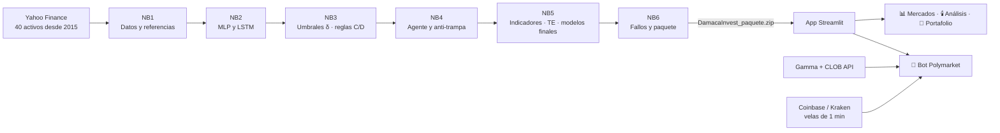

<div align="center">

# 📈 Damaca<span>Invest</span>

**Pronósticos financieros con Deep Learning (MLP y LSTM) y un agente que opera en Polymarket**


Proyecto final · *Deep Learning para Finanzas con Agente de IA* · 5.º semestre

[🚀 Abrir la app](#-despliegue) · [🧠 Metodología](#-metodología) · [🏆 Resultados](#-resultados) · [🎯 Bot Polymarket](#-bot-de-polymarket) · [⚙️ Instalación](#️-instalación)

</div>

---

> [!WARNING]
> Proyecto **académico**. Las señales y apuestas **no son asesoría financiera**. Los modos paper y sombra
> no usan dinero real. El modo real está bloqueado por tres llaves de seguridad y un monto máximo.

## 📌 ¿Qué es DamacaInvest?

DamacaInvest es una app web que:

1. **Pronostica** el rendimiento del siguiente periodo de **40 activos** (acciones, criptomonedas y divisas)
   con redes **MLP** y **LSTM** entrenadas en Google Colab.
2. **Convierte** cada pronóstico en una señal **LONG / SHORT / NEUTRAL** con reglas validadas sin hacer trampa.
3. **Muestra** indicadores técnicos (SMA20, Bollinger, RSI14, MACD, ATR14) sobre velas en tiempo real.
4. **Simula** un portafolio de 100,000 USD que sigue las señales de la IA.
5. **Opera** un bot en **Polymarket** sobre los mercados horarios *"Bitcoin / Ethereum Up or Down"*,
   con datos reales de las APIs Gamma y CLOB.

### Problema → solución

| Problema | Cómo lo resuelve DamacaInvest |
|---|---|
| Los rendimientos diarios son casi ruido y es fácil engañarse con resultados "demasiado buenos" | División temporal estricta, pruebas anti-trampa, configuración congelada y evaluación **única** en el conjunto de prueba |
| Un pronóstico con buen error estadístico no siempre gana dinero | Se mide el **valor económico** con un simulador realista (comisión 0.10 %, ejecución a la apertura siguiente) |
| Los modelos se quedan en un notebook | Los modelos finales se exportan a una **app** con pronóstico en vivo, portafolio y bot |

---

## 🗺️ Arquitectura



El agente sigue siempre el mismo ciclo:

```
Percepción ──► Modelo ──► Decisión ──► Acción ──► Recompensa
 (precios)     (ŷ_t)     (regla+δ)    (orden)    (PnL)
     ▲                                              │
     └──────────────── siguiente periodo ◄──────────┘
```

---

## 💹 Activos (40)

| Clase | Activos |
|---|---|
| **20 acciones de EE. UU.** | AAPL, MSFT, NVDA, AMZN, GOOGL, META, TSLA, AMD, INTC, NFLX, JPM, BAC, V, MA, JNJ, PFE, WMT, KO, DIS, XOM |
| **10 criptos (vs USD)** | BTC, ETH, SOL, BNB, XRP, ADA, DOGE, LTC, LINK, AVAX |
| **10 divisas** | USD/MXN, EUR/USD, GBP/USD, USD/JPY, AUD/USD, USD/CAD, USD/CHF, NZD/USD, EUR/MXN, EUR/JPY |

Datos diarios de Yahoo Finance desde 2015, con precios ajustados por dividendos y splits.

---

## 🧠 Metodología

Seis notebooks en Google Colab (GPU T4). Cada uno usa lo que deja el anterior en Google Drive.

| Notebook | Qué hace | Salidas clave |
|---|---|---|
| **NB1 · Datos y referencias** | Descarga con reintentos, auditoría de calidad, ficha de activos, objetivo $y_t = P_{t+1}/P_t - 1$ con 20 rendimientos rezagados, división **70 / 15 / 15** (TR / VA / TE) por fecha del objetivo y 4 referencias (cero, media, persistencia, media móvil) | `auditoria.csv`, `referencias.csv`, `experimentos.csv` |
| **NB2 · MLP y LSTM** | 2 redes × 3 configuraciones (16/32/64 neuronas) × 3 semillas (42, 7, 123) = **720 modelos**. Early stopping (paciencia 15, máx. 200 épocas) con validación interna; la mejor configuración se elige por **RMSE en VA** | `mejor_config_NB2.csv`, checkpoints |
| **NB3 · Umbrales** | 5 umbrales δ × reglas **C** (ŷ > δ) y **D** (ŷ > δ y precio > SMA20), evaluados en **3 ventanas expandibles de VA**. Simulador: 100,000 USD, comisión 0.10 %, ejecución a la apertura de t+1 | `config_umbral_NB3.json` |
| **NB4 · Agente** | Entorno de trading (estado, acción, transición, recompensa), transición calculada a mano, **6 pruebas anti-trampa**, oráculo como demostración y 5 políticas de referencia | `pruebas_antitrampa_NB4.json` |
| **NB5 · Indicadores, TE y futuro** | Versión **A** (rendimientos) contra versión **B** (+ distancia a SMA20, volatilidad de 20 días y RSI14; la LSTM B recibe `(n, 20, 4)`). Configuración **congelada con huella SHA-256**, evaluación **única** en TE con candado, modelos finales y pronóstico futuro | `resultados_TE.csv`, `pronostico_futuro.csv` |
| **NB6 · Fallos y entrega** | 4 fallos provocados, bitácora de errores, diccionario de datos, prueba de reproducibilidad, checklist y paquete para la app | `DamacaInvest_paquete.zip` |

### Reglas para no hacer trampa

- ✅ La división es **por fecha** y nunca mezcla días entre TR, VA y TE.
- ✅ La escala de los datos se calcula **solo con TR**.
- ✅ El early stopping usa una validación **interna de TR**; VA queda limpio para elegir la configuración.
- ✅ Umbrales y reglas se eligen **solo en VA**.
- ✅ TE se evalúa **una sola vez**. Si la configuración cambia después, el candado detiene el notebook.
- ✅ La señal se calcula al cierre de *t* y se ejecuta a la **apertura de t+1**.

### Fallos provocados (NB6)

| # | Fallo | Defensa que lo detecta |
|---|---|---|
| 1 | Entradas con información del futuro (`shift(-1)`) | Prueba de correlación entrada–objetivo (salió 1.000 contra 0.032 sin el fallo) |
| 2 | Escalar con datos de TE | Comparación contra la escala de TR |
| 3 | Datos corruptos (precio negativo, fecha duplicada, salto de +500 %) | Auditoría de NB1 |
| 4 | Ajustar δ después de ver TE | Candado SHA-256 |

---

## 🏆 Resultados

Evaluación **única** en TE (febrero 2025 → noviembre 2026), configuración congelada con huella `faf07ab201f705b3`.

### Configuración elegida (solo con VA)

| Elección | Resultado |
|---|---|
| Red | LSTM en 25 activos · MLP en 15 |
| Versión de entradas | A en 31 activos · B en 9 |
| Regla | C en 31 activos · D en 9 |

### IA contra comprar y mantener (promedio por activo en TE)

| Clase | Rend. IA | Rend. B&H | Sharpe IA | Sharpe B&H | Máx. caída IA | Máx. caída B&H |
|---|---:|---:|---:|---:|---:|---:|
| Acciones | +12.4 % | +35.5 % | 0.29 | 0.59 | −20.5 % | −30.5 % |
| Cripto | −27.6 % | −57.0 % | −1.06 | −0.73 | −31.6 % | −68.0 % |
| Divisas | −1.3 % | +1.3 % | −0.10 | 0.14 | −3.7 % | −10.6 % |
| **Total** | **−1.0 %** | **+3.8 %** | **−0.15** | **0.15** | **−19.1 %** | **−34.9 %** |

### Lectura honesta

- En promedio, la IA **no supera** a comprar y mantener en rendimiento ni en Sharpe. Le gana en Sharpe en el **30 %** de los activos, y en ninguna clase supera en promedio a comprar y mantener.
- Lo que sí logra la IA es **reducir el riesgo**: su máxima caída promedio es casi **la mitad** (−19 % contra −35 %). En cripto evitó buena parte de la caída (−27.6 % contra −57.0 %).
- El acierto direccional quedó en **50 %**, igual que una moneda al aire. Es lo esperado con rendimientos **diarios**, que tienen muy poca señal predecible.
- Los mejores casos (por Sharpe) fueron **INTC** (+217 % contra +100 %), **XOM** y **DIS**.

> Estos resultados se reportan **tal cual salieron**. Ajustarlos después de ver TE invalidaría la prueba,
> y el candado de NB5 lo impide.

---

## 🖥️ La app

| Pestaña | Contenido |
|---|---|
| 📊 **Mercados** | Los 40 activos con precio en vivo, cambio, pronóstico de la IA y señal LONG / SHORT / NEUTRAL; filtros y buscador |
| 🕯️ **Análisis** | Velas con SMA20, Bollinger, RSI14 y MACD; pronóstico del siguiente periodo, precio estimado y curva del activo en TE |
| 💼 **Portafolio** | 100,000 USD simulados; botón **"Ejecutar señales de la IA"** (máx. 8 posiciones), PnL realizado y no realizado e historial en CSV |
| 🎯 **Bot Polymarket** | Mercados horarios de BTC y ETH en vivo, P(Up) de la IA contra el libro de órdenes, apuestas e historial |
| 🏆 **Resultados** | Portafolio equiponderado en TE: IA contra comprar y mantener y contra efectivo, por clase y por activo |
| 🧠 **Modelo** | Flujo datos → modelo → señal, configuración congelada, A contra B, checklist y bitácora |

**Pronóstico en vivo:** la app carga los modelos finales (3 semillas promediadas) y recalcula ŷ con los
precios del día. Si un modelo no está disponible, usa el pronóstico guardado en NB5.

**Señales**

- **LONG:** se cumple la regla congelada del activo (ŷ > δ; con la regla D, además precio > SMA20).
- **SHORT:** ŷ < −0.2 % **y** precio < SMA20.
- **NEUTRAL:** en cualquier otro caso.

---

## 🎯 Bot de Polymarket

Opera los mercados **"Bitcoin / Ethereum Up or Down"** de cada hora (slug `btc-updown-1h-<inicio>`).
Según la descripción oficial del mercado, gana **Up** si el **TWAP de Chainlink** de la hora es mayor o igual
al precio de inicio.

### Probabilidad de la IA

Con $\mu_h = \hat y_{diario}/24$ y $\sigma_h = \sigma_{20d}/\sqrt{24}$:

- **Fórmula base del protocolo** (precio al cierre):

$$P(Up) = \Phi\left(\frac{\ln(P/\text{apertura}) + \mu_h\,\tau}{\sigma_h\sqrt{\tau}}\right)$$

- **Ajuste por TWAP** (lo que usa el bot): con $f$ = fracción de hora transcurrida y $A$ = promedio
  observado hasta ahora, el promedio de lo que falta debe superar $K = \dfrac{\text{apertura} - fA}{1-f}$:

$$P(Up) = \Phi\left(\frac{\ln(P/K) + \mu_h\,\tau/2}{\sigma_h\sqrt{\tau/3}}\right)$$

### Reglas

| Regla | Valor |
|---|---|
| Apuesta UP si | P(Up) − precio de UP ≥ ventaja mínima (5 puntos por defecto) |
| Apuesta DOWN si | (1 − P(Up)) − precio de DOWN ≥ ventaja mínima |
| Frecuencia | Máximo **una apuesta por activo y por hora** |
| Ventana prohibida | **Nunca** en los últimos 5 minutos |
| Límites de riesgo | P(Up) acotada a [2 %, 98 %] (Coinbase ≠ Chainlink); no compra a precios < 0.05 o > 0.95 |
| Ejecución simulada | Recorre el **libro real** del CLOB para calcular el precio promedio |
| Resolución | Resultado oficial de Polymarket; si no aparece en 10 min, TWAP de velas de Coinbase o Kraken |

### Modos

| Modo | Qué hace |
|---|---|
| **paper** | 10,000 USD de práctica con precios y libro reales |
| **sombra** | Registra qué haría y si habría ganado, sin mover saldo |
| **real** | Órdenes reales en el CLOB. Requiere **tres llaves**: `secrets.toml` con `modo = "real"` y llave privada, casilla de confirmación de riesgo y frase secreta. Monto máximo configurable |

El bot funciona en la pestaña 🎯 mientras la página esté abierta, o sin interfaz:

```bash
python bot_polymarket.py              # paper, revisa cada minuto
python bot_polymarket.py --modo sombra
python bot_polymarket.py --una-vez    # un solo ciclo
```

---

## ⚙️ Instalación

**Requisitos:** Python 3.11, Git.

```bash
git clone https://github.com/danielmac2809-dev/damacainvest.git
cd damacainvest
python -m venv %USERPROFILE%\.venvs\damacainvest
%USERPROFILE%\.venvs\damacainvest\Scripts\activate
pip install -r requirements.txt
streamlit run app.py
```

> En Windows con OneDrive, deja el entorno virtual **fuera** de la carpeta sincronizada (como arriba),
> para que OneDrive no sincronice los miles de archivos de TensorFlow.

### Paquete de modelos

Al final de NB6 se descarga `DamacaInvest_paquete.zip`. Descomprímelo en `paquete/` para que queden
`paquete/data/`, `paquete/models/` y `paquete/manifiesto.json`. La app también detecta la subcarpeta extra
que crea "Extraer todo" de Windows.

### Secretos (opcional)

Copia `.streamlit/secrets.toml.example` como `.streamlit/secrets.toml` y llena solo lo que uses.
Este archivo está en `.gitignore` y **nunca** se sube a GitHub.

### Reproducir los notebooks

Sube `notebooks/NB1 … NB6.ipynb` a Google Colab y córrelos **en orden**. Todo se guarda en
`MyDrive/DamacaInvest/`. NB2 y NB5 necesitan GPU T4 y son reanudables si Colab se desconecta.
Los notebooks se generan con `python notebooks/build_nbX.py`.

---

## 🚀 Despliegue

1. Sube el repositorio a GitHub (público).
2. En [share.streamlit.io](https://share.streamlit.io), elige **New app**, este repositorio, la rama `main` y el archivo `app.py`.
3. En **Advanced settings → Secrets**, pega el contenido de tu `secrets.toml` si lo usas.
4. Deploy.

🔗 **App publicada:** *(agrega aquí el enlace de Streamlit Cloud)*

---

## 📁 Estructura

```
damacainvest/
├── app.py                    # App Streamlit (6 pestañas)
├── bot_polymarket.py         # Bot sin interfaz
├── requirements.txt
├── src/
│   ├── config.py             # Activos y parámetros
│   ├── datos.py              # Yahoo Finance y lectura del paquete
│   ├── indicadores.py        # SMA20, Bollinger, RSI14, MACD, ATR14
│   ├── modelo.py             # Pronóstico en vivo y reglas de señal
│   ├── portafolio.py         # Portafolio simulado
│   ├── polymarket.py         # Motor del bot (Gamma, CLOB, probabilidad, apuestas)
│   ├── vistas.py             # Pestañas de la app
│   ├── vista_polymarket.py   # Pestaña del bot
│   └── estilo.py             # Tema oscuro tipo exchange
├── notebooks/                # NB1–NB6 (.ipynb) y sus generadores
├── paquete/                  # Modelos finales y resultados (salida de NB6)
│   ├── data/
│   ├── models/
│   └── manifiesto.json
└── .streamlit/
    ├── config.toml
    └── secrets.toml.example
```

---

## 🔒 Seguridad

- Las llaves viven en `.streamlit/secrets.toml`, que está en `.gitignore`.
- El modo real de Polymarket requiere tres llaves y respeta un **monto máximo por apuesta**.
- Antes de operar con dinero real, verifica que Polymarket permita operar desde tu país.
- El paquete incluye un **manifiesto con huella SHA-256** de cada archivo.

## ⚠️ Limitaciones

- Los rendimientos diarios tienen poca señal: el acierto direccional queda cerca del 50 %.
- El bot estima el precio con Coinbase o Kraken, y Polymarket resuelve con Chainlink; puede haber diferencias pequeñas.
- El bot dentro de la app solo trabaja mientras la página está abierta; para operar continuo se usa `bot_polymarket.py`.
- Streamlit Cloud no guarda archivos de forma permanente: el historial del portafolio y del bot se reinicia cuando la app se reinicia.

## 🛠️ Tecnologías

Python 3.11 · TensorFlow / Keras · pandas · NumPy · scikit-learn · yfinance · Plotly · Streamlit ·
requests · Google Colab (GPU T4) · APIs de Polymarket (Gamma y CLOB) · Coinbase y Kraken · GitHub · Streamlit Community Cloud

## 🗓️ Historial de versiones

| Versión | Fecha | Cambios |
|---|---|---|
| v0.1 | 26/11/2026 | Estructura del proyecto y notebooks NB1–NB6 |
| v0.2 | 27/11/2026 | App con 6 pestañas, pronóstico en vivo, portafolio simulado y bot de Polymarket (paper, sombra y real) |

## 👤 Autor

**danielmac2809-dev** · Proyecto final de *Deep Learning para Finanzas con Agente de IA*, basado en el
*Protocolo DL Finanzas con Agente de IA*.

<div align="center">
<sub>DamacaInvest · Hecho con 🧠 Deep Learning y ☕</sub>
</div>
